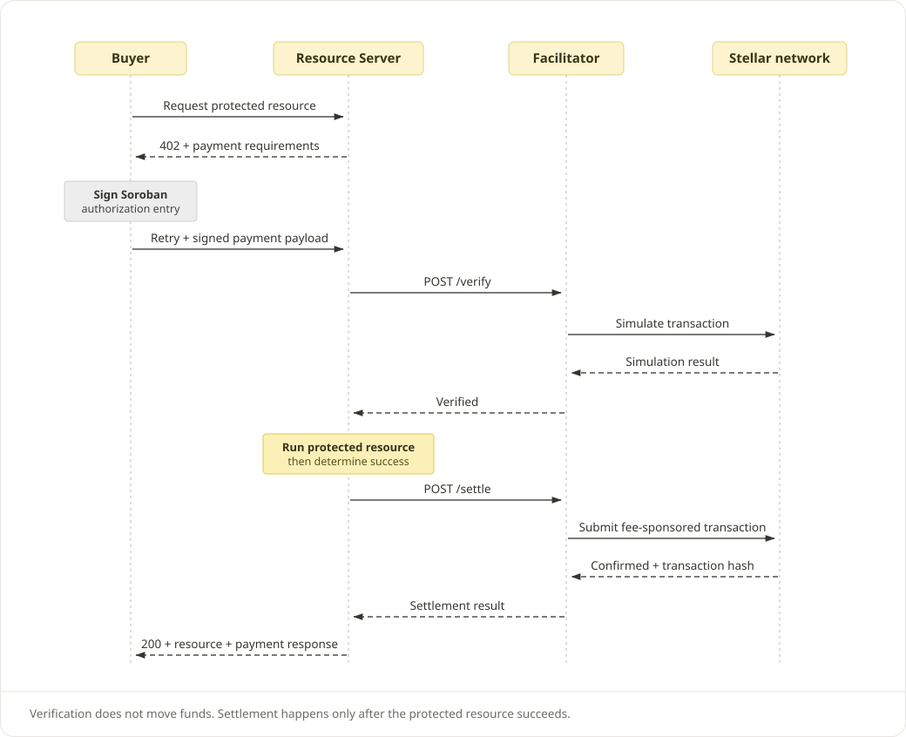

<a href="https://agentsmith.xyz/index.html">
  <picture>
    <source media="(prefers-color-scheme: dark)" srcset="assets/agentsmith-logo-dark.svg">
    
  </picture>
</a>

AgentSmith provides a self-hostable, non-custodial Stellar x402 Facilitator and a payment SDK
for Resource Servers (Sellers), Buyers, and agents. The Facilitator verifies Buyer authorizations,
sponsors Stellar network fees, and settles payments without holding Buyer funds.

[Official website](https://agentsmith.xyz/index.html)

_This code is not yet finalised and may change in future releases._

This repository is a pnpm workspace monorepo:

| Directory                                        | Status      | Purpose                                                                          |
| ------------------------------------------------ | ----------- | -------------------------------------------------------------------------------- |
| [`packages/facilitator/`](packages/facilitator/) | Runnable    | Standalone Stellar `exact` Facilitator with optional experimental `upto` support |
| [`packages/x402-sdk/`](packages/x402-sdk/)       | Implemented | Seller payment integration and Node Buyer paid-fetch helpers                     |
| [`packages/bazaar/`](packages/bazaar/)           | Reserved    | Future Bazaar discovery service; no Bazaar server is included yet                |

The Facilitator runs without Bazaar. Its optional Bazaar settlement callback is disabled unless explicitly configured.

## Environments

AgentSmith has two environments: **testnet** for development and testing, and **mainnet** for real payments.

| Environment | x402 network      | API key requirement                                        |
| ----------- | ----------------- | ---------------------------------------------------------- |
| Testnet     | `stellar:testnet` | Optional for payment routes; a supplied key must be valid. |
| Mainnet     | `stellar:pubnet`  | Required for `/supported`, `/verify`, and `/settle`.       |

For mainnet, the Resource Server sends its API key as `Authorization: Bearer <API_KEY>` when
calling the Facilitator. Keys are issued through the database-backed credential API; see the
[Facilitator README](packages/facilitator/README.md#configuration) for registration and key management.
Self-hosted deployments run a separate instance and configuration for each network.

## Payment flow



1. A Buyer requests a paid resource; the Seller responds with a `402` payment challenge.
2. The Buyer signs a payment authorization and retries the request.
3. The Seller asks the Facilitator to verify the authorization, runs its business handler, and requests settlement.
4. The Facilitator submits a fee-sponsored Stellar transaction; the Seller returns the result with a payment receipt on successful settlement.

`exact` charges the quoted amount. Experimental `upto` authorizes a ceiling and settles actual
usage through a separately deployed Soroban Kernel; it is not yet an upstream x402 scheme.

## SDK integration

See the [SDK README](packages/x402-sdk/README.md) for installation and examples:

- **Sellers:** Express and NestJS (Express adapter) payment middleware, or native resource-server composition.
- **Buyers and agents:** Node paid fetch with Stellar signing and optional payment-approval hooks.

## Self-hosted testnet quick start

Prerequisites:

- [Node.js 24+](https://nodejs.org/en/download)
- pnpm 10.6.5 — pinned in `package.json`; run `corepack enable` to use the pinned version
- [Docker Desktop](https://docs.docker.com/get-docker/) (macOS/Windows) or Docker Engine
  with the Compose plugin (Linux) — provides `docker compose` for local PostgreSQL and Valkey

Run these commands from the repository root:

```bash
pnpm install --frozen-lockfile
cp packages/facilitator/.env.example packages/facilitator/.env
pnpm --filter @agentsmith/stellar-facilitator testnet:create-account
# Copy the three printed FACILITATOR_STELLAR_* lines into packages/facilitator/.env.
# Keep the example DATABASE_URL and CHANNEL_STORE_URL for these local services.
docker compose -f packages/facilitator/docker-compose.yml up -d postgres valkey
pnpm build
pnpm start
```

The service requires PostgreSQL and a Redis-protocol channel store (Valkey here). It applies pending
database migrations before listening at `http://127.0.0.1:8407`. The default configuration enables
testnet `exact` and experimental `upto`; `upto` uses the pre-deployed testnet Kernel, so no Kernel
deployment is required.

See the [Facilitator README](packages/facilitator/README.md) for credentials, production signing,
network configuration, and experimental `upto` setup.

## Development

Use `pnpm dev` for development and `pnpm check` for the workspace verification gate. To run a
service-specific command, use `pnpm --filter @agentsmith/stellar-facilitator <command>`.
Add implemented packages to `pnpm-workspace.yaml`; internal dependencies use `workspace:*`.
The reserved Bazaar directory is not a package yet.

End-to-end tests run against a running facilitator on `stellar:testnet`, paying with
friendbot-funded accounts. Set `E2E_FACILITATOR_URL` to the target — the local service from the quick
start by default, or a deployed testnet facilitator — and run:

```bash
E2E_FACILITATOR_URL=http://127.0.0.1:8407 pnpm --filter @agentsmith/stellar-facilitator test:e2e
```

`E2E_FACILITATOR_URL` also defaults from `packages/facilitator/.env`. See the
[Facilitator README](packages/facilitator/README.md#testnet-quick-start) for `E2E_CHANNEL_COUNT` and
the separate pubnet smoke test.

Build the container from the root with `docker build -f packages/facilitator/Dockerfile .`.
When running the Facilitator in a container, configure `DATABASE_URL` in its environment to reach
PostgreSQL from inside the container; the example's loopback address is for host-based development.

Do not commit `.env` or Stellar secret keys. Source code is licensed under [Apache-2.0](LICENSE).
